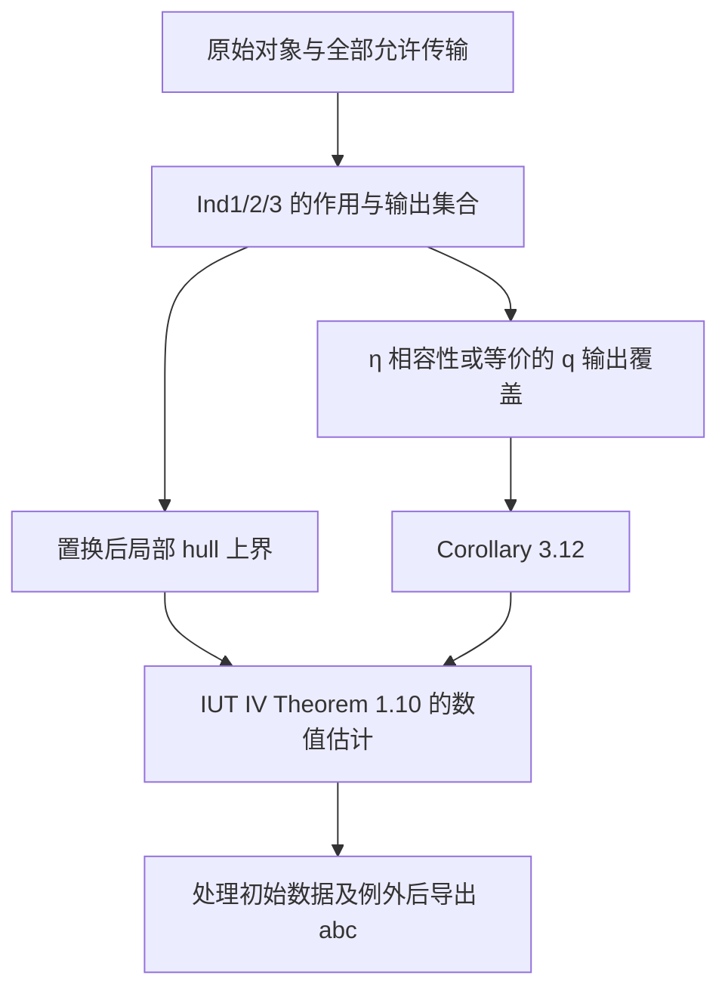

# IUT 争议与补救义务：一手文献审计

检索日期：2026-10-16（Asia/Shanghai）。状态：研究材料；不是经过 Lean 检验的数学结论，不能直接加入 fact-tree。阅读范围按 sources.json 标明。这里没有声称已经穷尽全部批评，也没有声称解决 abc 猜想。

## 1. 争论对象必须分开

| 类别 | 例子 | 应如何处理 |
|---|---|---|
| 对原证明具体步骤的数学异议 | IUT III 的 Theorem 3.11 → Corollary 3.12；IUT IV 的局部 hull 估计 | 精确命题化、补齐量词及依赖，再验证 |
| 对简化模型的数学异议 | SS 的一维实直线六边形 | 先检验模型，再证明它忠实表示原证明；模型反例不自动反驳原理论 |
| 对替代理论的异议 | Joshi 的 Arithmetic Teichmüller Spaces 与原 IUT 的对应 | 单独审核，不把替代理论成功或失败自动转移给 IUT |
| 传播、评审、机构、人格意见 | 发表程序、理解人数、措辞、奖项 | 可作历史背景，不作数学推理前提 |

支持研究 IUT 的可执行含义是优先尝试修补和精确化；不能把支持立场用作定理假设。

## 2. 历史定位与阅读记录

- **2012–2021 原论文。** IUT 系列以 2012 RIMS 预印本形式发布，2021 年刊于 PRIMS。此次读取 IUT III 官方 2020 预印本的导言 pp.16–19、Corollary 3.12 附近及相关检索片段。定义把 Θ 侧数值写为不定性下可能像之并的 holomorphic hull 的 log-volume，允许先验取 +∞，并不是普通复数对数的绝对值。[IUT III](https://www.kurims.kyoto-u.ac.jp/~motizuki/Inter-universal%20Teichmuller%20Theory%20III.pdf)
- **2018 分歧。** 三月京都讨论后，Scholze–Stix 与 Mochizuki 分别给出报告。官方讨论页同时保留两版 SS 报告与回应，适合做版本入口；不能把一方对讨论经过的叙述当作双方共同认可的记录。[讨论材料入口](https://www.kurims.kyoto-u.ac.jp/~motizuki/IUTch-discussions-2018-03.html)
- **2020–2025 阐释。** Dupuy–Hilado 2020 年文献明确不证明 Corollary 3.12；2025 年 arXiv:2004.13228v2 已拆分，当前标题及范围只覆盖 Initial Theta Data，不能继续把旧摘要当新版摘要。[版本记录](https://arxiv.org/abs/2004.13228)
- **2025–2026 形式化进展。** Mochizuki 2025 报告讨论 Lean；2026-04 报告自述尚处 Stage 1 的早期骨架阶段，骨架代码当时尚需充实才适合公开。它区分 3.11 → “3.11.5” 与 “3.11.5” → 3.12，后者不是原系列中的定理编号。[2025 报告](https://www.kurims.kyoto-u.ac.jp/~motizuki/IUT-report-2025-10.pdf)，[2026 报告 pp.3–4,11](https://www.kurims.kyoto-u.ac.jp/~motizuki/Formalization%20of%20IUT%20(2026-04).pdf)
- **2026-07 LANA。** ZEN 官方公告说明项目对是否已有 abc 证明保持判断，集中追问两种 q-pilot 体积计算为何等价、何种输出等于由输入确定的数据。不是“Lean 已经证明 IUT”的公告。[ZEN 原公告](https://zen.ac.jp/news/zmcpostevent0717e)
- **2026-10 新局部异议。** Urahigashi 独立短文针对 IUT IV Step (v) 的一项局部包含关系，必须与 Corollary 3.12 争论分开，详见第 5 节。[固定 tag 的 TeX](https://raw.githubusercontent.com/turahigashi/iut-explicit-initial-theta/v0.8.0/stepv-local-noncontainment/paper/stepv_local_noncontainment.tex)

## 3. 主要数学异议与回应（均为作者主张，未被本项目认证）

### C01：SS 的尺度与单值相容性异议

来源：Peter Scholze、Jakob Stix，*Why abc is still a conjecture*，§1.3 pp.3–4，§2.1.8–2.2 pp.8–10；立场：原证明有严重缺口。[原文](https://www.math.uni-bonn.de/people/scholze/WhyABCisStillaConjecture.pdf)

SS 区分抽象 pilot、具体 divisor、其算术 degree。具体 theta 分量是 q 的 j² 次幂；抽象 prime-strip 生成元与具体 degree 间的尺度不可同时遗忘和保留。他们的六边形若要求一致识别，则绕行产生 j²；改用一致尺度会消掉关键 j²，使目标退化为空洞界。他们也担心用不定性吸收差异须付出 ℓ² 级损失。这是针对简化模型及其对原论证的适用性的论证，不能直接提升为已形式化的 IUT 反证。

### C02：望月对该模型的回应

来源：Shinichi Mochizuki，*Comments on the manuscript (2018-08 version) by Scholze–Stix*，C10–C14，pp.3–4；立场：SS 简化移除了关键结构。[原文](https://www.kurims.kyoto-u.ac.jp/~motizuki/Cmt2018-08.pdf)

望月强调一个 Θ-pilot 的各分量、不同 arithmetic holomorphic/ring structures、tensor packets 上的 multiradial representations；不是把全部数据以恒等映射合并。他指出对受不定性影响的区域取 log-volume，关系依赖区域几何，并非固定正实数倍。2018 长报告 §10、§12 进一步讨论 id-version、common container 与体积例子；本次只定位相应材料，尚未逐行审核这些长段落。[长报告](https://www.kurims.kyoto-u.ac.jp/~motizuki/Rpt2018.pdf)

不能由“存在非线性 hull 操作”直接推出 Corollary 3.12；真正义务仍是证明指定的 q-pilot 位于指定输出集合/体积值集合。

### C03：当前 LANA 的 η 相容性目标

来源：LANA，*Project LANA Interim Report on IUT Theory*，章节标签 `sec:pointsToClarify`、`sub:theMainGoal`、`sub:SSAssessmentNew`；立场：暂缓裁决。[完整原始 TeX](https://raw.githubusercontent.com/katobungen/LANA_report_202607/main/LANA_report_202607.tex)

该报告把核心待证条件表达为：存在适当积分结构 S，使 η^q = η^{anab}_S；前者来自 q 的原生环结构，后者来自 anabelian/Kummer 重建与 S。它承认 SS 六边形不交换，但认为完整算法未必经此图分解；同时明确当前没有上述 η 等式的证明。仅说两个 BPS 存在同构不足以给出所需相容性，IPL 的含义需要更精确。

### C04：替代框架不等于补齐原证明

来源：Kirti Joshi，*Final Report on the Mochizuki–Scholze–Stix Controversy*，§1.2–1.4，2025 v1；立场：反对 SS 结论，同时认为望月原证明不完整。[原文](https://arxiv.org/html/2505.10568v1)

Joshi 质疑 arithmetic holomorphic structures 的量化不足以严格证明存在并比较多个此类结构，声称自己的框架补足。这里只记录其异议及替代方案；未审核他引用的整套证明，不能声称已经补齐 Theorem 3.11 或 abc。[Arithmetic Teichmüller Spaces III](https://arxiv.org/abs/2401.13508) 为待审读条目。

### C05：条件式后果不消除核心前提

来源：Taylor Dupuy、Anton Hilado，arXiv:2004.13228v1 摘要、arXiv:2004.13108v2 Theorems 1.0.3–1.0.5 与 §6.2 footnote 7；立场：解释及导出条件式结果。[初始数据旧版](https://arxiv.org/pdf/2004.13228v1)，[Szpiro 论文](https://arxiv.org/pdf/2004.13108)

后者定理显式假设 Corollary 3.12 和 Claim 5.0.1。§6.2 toy bound 的脚注提示实际 Ind1 包含示例未表示的跨 tensor factor 置换。因此，引用这些文献不能消除 Corollary 3.12、无穷位估计或完整置换的审计义务。

## 4. 面向 Lean 的补救与迁移研究任务

本节是本项目提出的研究规范，不是现成的 IUT 定理。

1. **保留尺度的有类型图。** 将每个 theater、prime-strip、value line、volume container 分别作为带索引类型。所有传输显式给出定义域/值域；把“等同”拆为同构、自然变换、集合包含或实数相等。Lean 的 universe 标签本身不会证明数学传输正确。
2. **对数值不变量做数据处理审计。** 比较两个算法前，写出它们实际消耗、遗忘、重建了哪些结构。用范畴论自然性或交换条件表达“同一输出”；禁止把“可同时运行”偷偷加强为“结果相同”。
3. **群作用与轨道覆盖。** 明确 Ind1、Ind2、Ind3 的作用空间和允许组合，证明 orbit/hull 单调性，再证明目标 q 数据被覆盖。对每个 toy 模型附带到真实 IUT 对象的实现/精化定理；缺少精化只能记为模型结果。
4. **测度与凸分析。** 将 hull、并、sup、积分结构及 Haar/log-volume 放在具体域上，区分线性标量传输和非线性区域操作。检查有限性、可测性、归一化、局部维数、期望权重以及局部到全局求和。
5. **量词与误差预算。** 对所有 ℓ、j、places、辅助选择与 S 明确先后量词。任何修补须维持能导出目标 Diophantine 界的误差预算；“增加不定性”不是免费操作。
6. **反例优先的有限实验。** 对有限标签/有理数尺度/离散估值阈值建立可执行模型，搜索遗漏的置换，再把发现整理成证明义务。随机采样不能验证全称命题。
7. **因果依赖隔离。** 使用 theorem parameters 显式传入未证前提，拒绝将核心争点藏为结构字段或全局 axiom。即使条件式证明无 warning，也只认证该条件式，不认证前提的真实 IUT 实例。

建议依赖图分支（全部是待办节点，不属于已认证 fact-tree）：

## 5. C06：Urahigashi 2026-10 的 Step (v) 局部包含异议

固定版本：GitHub tag **v0.8.0** 下 `stepv-local-noncontainment/`。README 将独立短文标为 **Version 1.0.0，Draft 5 October 2026，6 页**。作者 **Toshihisa Urahigashi**。DOI 线索为版本记录 [10.5281/zenodo.23166433](https://doi.org/10.5281/zenodo.23166433)，README 给全版本 DOI [10.5281/zenodo.23166432](https://doi.org/10.5281/zenodo.23166432)。本次 DOI 页面读取失败；版本内容身份依据实际下载的 tag 压缩包与 SHA256 清单核对，不假称核实 Zenodo 元数据。

已读取该 tag 的 [一手 TeX §§1–5](https://raw.githubusercontent.com/turahigashi/iut-explicit-initial-theta/v0.8.0/stepv-local-noncontainment/paper/stepv_local_noncontainment.tex)。作者声称：取 F₀=ℚ(√5)、ℓ=7、p=30965771，有两乘法约化处 ρ(b₁)=1/7、ρ(b₂)=6/7。在 j=3 时，Ind1 置换 (2 3) 把估值 9/7 的 theta 元素移到目标 tuple (b₁,b₁,b₁,b₂)。Step(v) 用末标签取 λ=54/7，却得到比所需 hull 更小的局部上界。短文明确不裁决 Corollary 3.12、最终全局不等式或 abc。此主张未在本项目 Lean 中验证，尤其 §4 对实际允许传输的解释尚待核实。

文件身份核对：

| 文件 | SHA256（内存实算，与 tag 内 SHA256SUMS 相同） |
|---|---|
| paper/stepv_local_noncontainment.tex | `41ae83d7fbac75604b894de9ba4e357740af20dda1d8c05139ff891415162aa0` |
| paper/stepv_local_noncontainment.pdf | `d23d2eb4f867fda35198a3358d9e26550fd761f1a18bdd2a2d37dc35f2de25fe` |

未执行该仓库代码；哈希一致只证明拿到同一批字节，不证明其数学正确。README 说明旧 p=211 报告的来源应用曾在 v0.1.7 撤回；本短文是另一篇论文，不能混用旧结论。声明大量使用生成式 AI 也不构成正误证据。

待验证链：

- 对照原 IUT III 的 procession、splitting monoid、Kummer isomorphism 与 Ism，检验 §4 的两条 membership/transport 引理，尤其置换后使用的是哪个来源 q 参数。
- 独立建立初始 theta datum，验证所有全局前提，而不是只验几个有理数。
- 建立张量 packet、integral closure、log-shell、automorphism、hull 的精确实例，核实局部 non-containment。
- 单独核实 IUT IV Step(v) 确实宣称该 tuple 的同一个包含关系；若成立，研究可统一覆盖所有置换像的修正上界，并追踪全局误差。
- 仅有上述局部结果也不能直接推断整个 abc 证明不可修复；其作用是新增一条需要处理的依赖分支。

## 6. 尚未完成与边界

- 尚未逐行审计 IUT I–IV、anabelian 前置理论、2018 长报告、2024 Essential Logical Structure、2025–2026 全部相关预印本。
- 没有为 C01–C06 的真实 IUT 内容提供本项目 Lean 证明。
- 未将任何文献立场或模型启发当作已认证事实。
- 后续检索应补 Roberts 原始评论、Joshi 各版与望月回应、LANA 更新及其 η 定义的精化；应先核对作者、版本、适用对象，避免循环转述。

