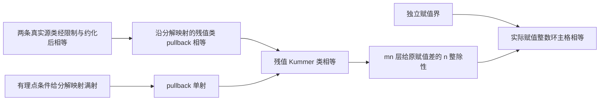

# 从残值比较到实际局部主格

日期：2026-10-24。本轮继续前轮 Kummer 工具，目标是减少具体假设并尽量靠近实际 germ 来源。本文最终状态以本目录验证证据为准；不据此关闭原始 tempered/IUT Corollary 3.12 gap。

## 已得到的数学接口

1. **任意整数值赋值域**：将 Qp 的赋值分离推广到任意 `v : Valuation K ℤᵐ⁰`，整数区域取真实 `v.valuationSubring`。无需假定赋值满射、非平凡、无分歧或域等于 Qp。`WithZero.log` 是乘法值群的整数指数，符号与通常 ord 相反；所有相等/绝对差结论不受影响。非零条件不能删除，因为 log(0) 是垃圾值。
2. **实际有限点完备化**：取 `w.maximalIdeal.adicCompletion K` 与 `Valued.v`，证明整数区域就是 `adicCompletionIntegers`，并检查该环的 DVR 实例。此底层域表达式与固定 IUT 源码 `Iut.Concrete.LocalTheory.completionAt` 的定义相同；本轮没有导入整个 IUT 或构造 Hodge theater。
3. **有限精度损耗**：若归一化幂为 m≠0，在第 mn 层有 κ(x^m)=κ(y^m)，则 n 整除原整数赋值差。只要另有 |差|<n 即恢复主格。m 与 n 不必互素；m=ell、n=ell^k 对应在 ell^(k+1) 层比较、得到 ell^k 的赋值精度。不会由第 ell 层上 κ(b^ell)=1 恢复 κ(b)。
4. **只反映残值侧**：真实 specialization 方块的左端是限制+系数约化，右端是沿 decompositionMap 的 pullback、系数为 identity。左端的相等经右侧 pullback 单射即可恢复残值 Kummer 类，不需要 reduceMu 可逆，也不反推出原来的未约化源类相等。
5. **有理点分解映射**：单独移植新版的满射证明，并使用已有连续性。原源码的有理点、代数闭及残值代数性条件均保留，不能把它当成任意 restriction 都单射。
6. **Laurent germ 条件**：已从 A 包含 k[[X]] 且 X 的残数为0，证明 A 在 k((X)) 上的限制恰为幂级数赋值环，进而每个可约化 Laurent 元素的残值是 k 中的常数。证明采用 DVR 的严格扩环只能是域的性质；不是把有理残值条件作为新字段。该模型使用明确构造的共同常数嵌入、标量作用和标量塔，不能直接宣称覆盖任意外部提供的实例。

统一入口：`candidates/core-kummer/Boundary/Frontier.lean`。它由 `assemble.py` 按固定顺序将六个源片段原文组合，去重 imports，不改定理正文；映射和 SHA256 记录在 `assembly.json`。用统一入口复验，避免把相同的完整 Mathlib 依赖为每个片段重复载入。不要在同一 Lean 文件同时 import Frontier 和组成片段模块，它们保留相同声明名。

## 与真实来源的关系

原始 IUT 的比较仍必须提供最左端的实际源类比较，并证明 theater、cyclotome、标签、归一化和允许域同步。一般 germ 方块或任意 `ofData` 不能代替这些对象。这条局部路径也尚未比较全局包络的 Haar/log-volume 或证明误差预算。

终端定理是 `CoreLaurentPoint.principal_eq_of_powerSeries_comparison`：输入实际幂级数单位 r、s，其常数项为 a^m、b^m；在 mn 层上的真实约化限制类比较，加上原赋值差的独立严格界 <n，推出 a、b 关于实际赋值整数环的主格相等。相对于一般 DecompositionBridge，它已经消除了手工提供 hres、函数在 A 中的单位性及其残值等式：这些由 hA/hX、幂级数单位和常数项计算推出。仍保留 Galois/代数闭、残值代数性、根存在及源类比较等真实前提。

## 来源与移植

七个新增上游模块的初始逐字复制记录见 `source-files.json`。六个来自 continuous-kummer-theory pin `98b67dfe9c82415aa17caa633d93960b6829af2e`；新增 `DecompositionSurjective` 来自明确另记的 `1d5194fcc63ddeb7a8cdb6c98d59452503db60fa`。不会把新版文件说成旧 pin 已含有的结论。

当前 Mathlib 为 `85e3a25e006c35636f0e53b0e9296caca2685bc0`、Lean 4.34.0-rc2；上游原为 Lean4.32。移植将 Prop 的 haveI 改 have、采用新 ite 名称和 isIntegral_algebraMap_iff 参数，并在两处半透明实例的旧 rw 中使用 erw；不关闭 linter、不加入 sorry/axiom。最终补丁与源字节另见移植记录。前轮四个已验证文件与 lakefile 未改，旧分片的输入校验仍通过。

`build-import-results.json` 保留首次流水线在 Corestriction 停止的失败尝试，不能拿它宣称全通过。后续主任务分别修复并重放；成功以最终日志和执行返回的退出码为准。子代理 Luna 完成来源/依赖闭包及脚本准备；Astra 提供了赋值与 Laurent DVR 路线，后因用量限制停止。主任务负责落地证明和最终验收。

## 最终验证状态

统一入口严格构建退出 0；36 条公理报告（35 个本轮选定声明、1 个上游满射定理），只含 propext/Classical.choice/Quot.sound。导出器独立运行退出 0，索引为 35 个选定声明、6 个同模块辅助常量、87 条直接依赖边。实际 VS Code 已处理至最后一项 `principal_eq_of_powerSeries_comparison`，36 条信息、零错误、零警告。观察、截图及源文件 SHA256 保存在 `editor/`；已写 `fact-tree/core-boundary-2026-10-24.json` 独立 VERIFIED_LOCAL_SHARD，中央 registry 未改。前两轮分片新鲜度检查也仍通过。

一般外部 scalar-tower 版本的重复 elaboration 失败已记录并暂停；当前规范构造版本已通过。详见 `GAP-laurent-scalar-instance.md`，该工程性修复不关闭任何原始 IUT gap。

快速调用：`python -B research/core-boundary-2026-10-24/index.py --query principal_eq_of_powerSeries_comparison` 返回内核导出的精确类型、公理和依赖边。`--check` 只检查已保存验证输入的哈希、索引与分片是否匹配，不重新运行 Lean。

需要重新编译时，先在 `candidates/core-kummer` 运行 `lake build CoreKummer` 准备前轮依赖，再从仓库根运行 `research/core-boundary-2026-10-24/build-imports.ps1`，最后在该候选工程运行 `lake env lean -DwarningAsError=true -o .lake/build/lib/lean/Boundary/Frontier.olean Boundary/Frontier.lean`。已有依赖 artifact 时只需最后一条。不要把 CLI 重跑当成新的编辑器观察。

本轮没有声称这些初等代数/赋值论组合是学界首创；推进的是经过核验、能消费具体来源对象的形式化接口。下一步的核心数学任务见 `NEXT.md`。
